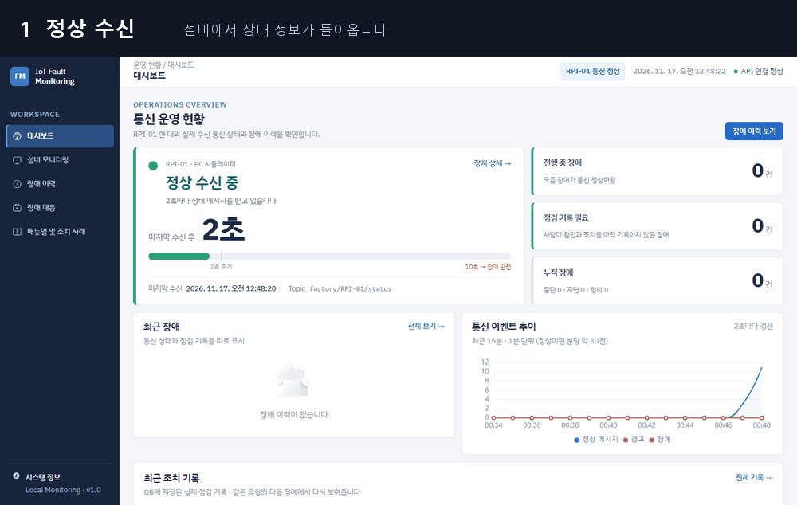
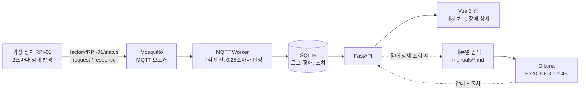
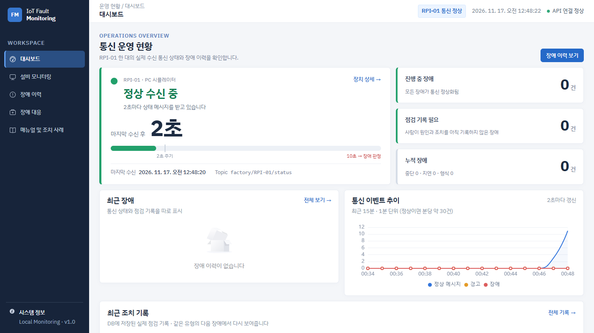
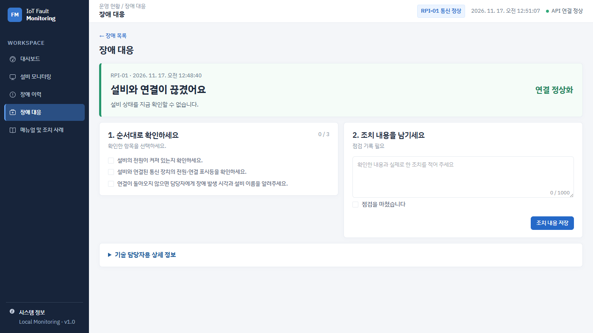
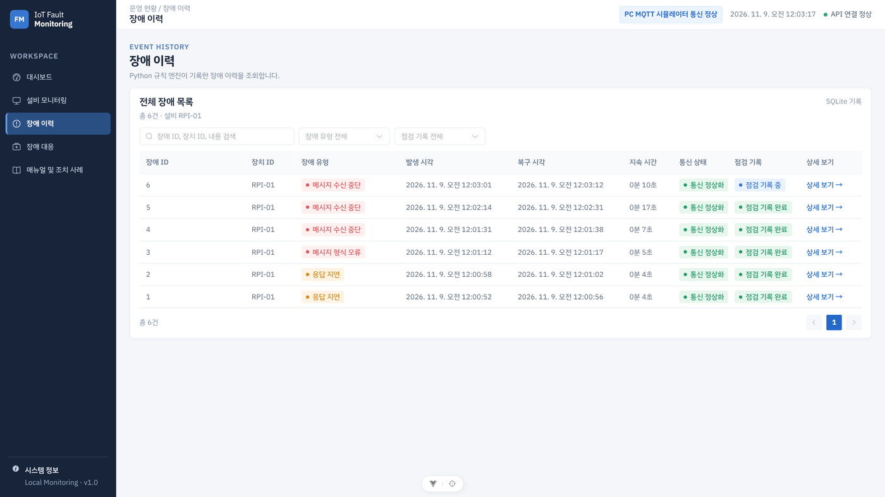
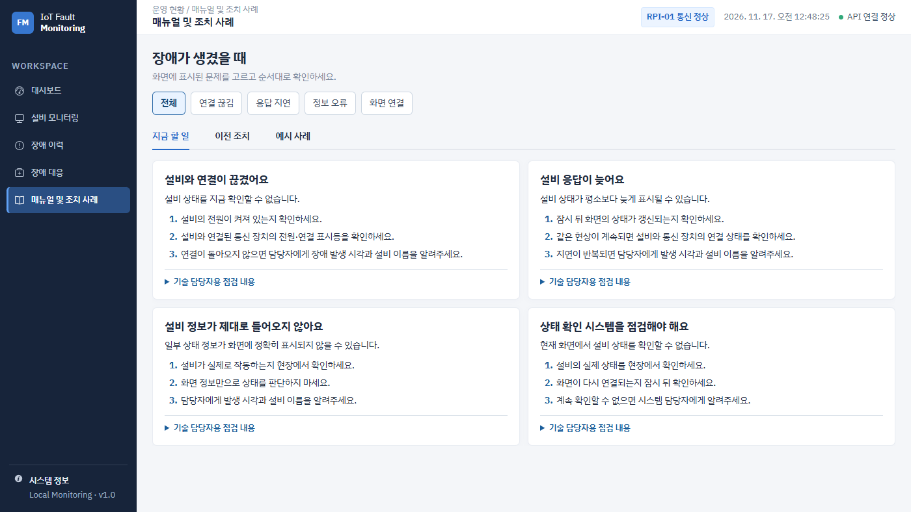

# 설비 통신 장애 대응 지원 웹

설비의 상태 메시지가 끊기거나 요청에 대한 응답이 늦어지면 이를 감지해 화면에 표시합니다. 장애가 났을 때는 점검 순서와 조치 기록을 먼저 볼 수 있게 했고, 통신 로그와 원본 매뉴얼은 상세 정보에 넣었습니다.



가상 장치를 끄면 약 10초 뒤 통신 중단이 표시됩니다. 다시 켜면 복구 시각이 기록되고, 마지막에는 장애 대응 화면이 나옵니다.

**발표 자료:** [HTML 발표 화면 바로 보기](https://ryusb2295.github.io/iot-fault-assistant/)

| 항목 | 내용 |
| --- | --- |
| 판정 대상 장애 | 메시지 수신 중단(10초), 응답 지연(3초), 메시지 형식 오류 |
| 판정 시간 | 판정 기준 대비 최대 0.27초 이내 (유형별 5회, 총 15회 측정) |
| 인공지능 점검 안내 | Ollama `exaone3.5:2.4b` 로컬 모델, 참고한 매뉴얼의 파일명과 줄 번호 표시 |
| 테스트 | 백엔드 자동 테스트 43개 |
| 사용 기술 | Python, paho-mqtt, FastAPI, SQLite, Mosquitto, Vue 3, Element Plus, ECharts, Ollama |

## 개발 배경

설비와 통신이 끊기면 언제부터 문제가 생겼는지, 무엇을 확인해야 하는지 알아야 합니다. 기존에는 로그와 매뉴얼, 이전 조치 기록을 따로 봐야 했습니다. 이 프로젝트에서는 장애를 기록한 뒤 점검하고 조치 내용을 남기는 과정을 한 화면에서 이어지게 만들었습니다.

```
메시지 수신 → 규칙 기반 판정 → 장애와 로그 기록 → 매뉴얼 기반 점검 안내 → 조치 기록 → 다음 장애에서 재사용
```

장애 판정은 Python 코드가 맡습니다. 메시지 수신 시각과 내용으로 장애 유형, 발생 시각, 복구 여부를 정합니다. 로컬 언어 모델은 판정 결과를 바꾸지 않고, 매뉴얼과 로그를 참고해 점검할 내용을 제안합니다. 관련 매뉴얼이 없으면 모델을 호출하지 않습니다.

## 시스템 구조



- 메시지를 받는 프로그램과 웹 서버는 따로 실행합니다. 같은 SQLite 파일을 사용하므로 웹 서버가 꺼져도 메시지 수신과 장애 판정은 계속됩니다.
- 언어 모델도 로컬 PC에서 실행합니다. 설비 로그는 외부 서비스로 보내지 않습니다.

### 장애 판정 규칙

| 장애 | 코드 | 판정 기준 | 복구 판정 |
| --- | --- | --- | --- |
| 메시지 수신 중단 | `CONNECTION_TIMEOUT` | 마지막 유효 상태 메시지 수신 후 10초 동안 메시지 없음 | 정상 상태 메시지 재수신 |
| 응답 지연 | `RESPONSE_DELAY` | 요청 후 3초 이내에 응답 없음 | 지연된 응답 도착 |
| 메시지 형식 오류 | `INVALID_MESSAGE` | 필수 필드 누락, 자료형 오류, JSON 파싱 실패 | 다음 정상 메시지 수신 |

## 주요 화면

| 대시보드 | 장애 상세 및 대응 |
| --- | --- |
|  |  |
| 마지막 메시지를 받은 뒤 몇 초가 지났는지와 10초 기준선을 표시합니다. 진행 중인 장애와 최근 15분의 통신 기록도 볼 수 있습니다. | 장애 내용과 점검 순서, 조치 입력란을 먼저 보여줍니다. 로그와 원본 매뉴얼, 언어 모델의 안내는 상세 정보를 펼쳐 볼 수 있습니다. |

| 장애 이력 | 매뉴얼 및 조치 사례 |
| --- | --- |
|  |  |
| 통신이 복구됐는지와 사람이 점검 내용을 남겼는지를 따로 표시합니다. 통신이 돌아와도 점검 기록이 없으면 '점검 기록 필요'로 남습니다. | 매뉴얼 4종의 점검 순서를 쉬운 말로 적었습니다. 원본 기술 내용은 접어 두고, 실제 조치 기록과 실습용 예시는 탭으로 나눴습니다. |

## 개발 중 해결한 문제

### 1. 장치 재연결 후 응답 지연 장애가 잘못 기록되는 문제

장치를 10초 넘게 껐다가 다시 실행했을 때, 통신 중단 장애 외에 약 28초짜리 응답 지연 장애가 여러 건 기록됐습니다.

원인은 장치가 꺼진 동안에도 수신 프로그램이 6초마다 요청을 보낸 데 있었습니다. 장치가 다시 연결되자 쌓인 요청에 한꺼번에 응답했고, 프로그램은 이를 28초 늦은 응답으로 잘못 판단했습니다.

수정한 내용은 다음과 같습니다.
- 최근 4초 이내에 상태 메시지를 받은 경우에만 요청을 발행하도록 수정했습니다(`device_alive`).
- 요청 후 3초 동안 응답이 없고 그 사이 상태 메시지도 수신되지 않았다면, 응답 지연이 아닌 장치 무응답(`NO_RESPONSE`)으로 로그만 남기도록 했습니다.
- 통신 중단 중에 발행된 요청은 별도로 표시해 두고, 재연결 후 도착한 응답은 `STALE` 로그로만 기록하도록 했습니다.

수정 후 같은 실험을 다시 했을 때는 통신 중단 장애 1건만 기록됐고, 장치를 켜자 복구 시각도 남았습니다.

### 2. 장치 재시작 시 이전 요청이 응답 지연으로 남는 문제

요청을 보낸 직후 장치를 재시작하면, 이전 요청이 응답 지연 장애로 남는 문제도 있었습니다.

재시작된 장치는 이전 요청에 응답할 수 없는데, 판정 프로그램은 응답을 계속 기다리고 있었습니다.

상태 메시지의 `sequence` 값이 이전 값보다 작거나 같으면 장치가 재시작된 것으로 판단합니다. 이때 재시작 전 요청은 대기 목록에서 지웁니다.

이후 장치 재시작이 응답 지연 장애로 잘못 기록되지 않는 것을 확인했습니다.

### 3. 감시 시스템 중단을 장치 고장으로 오판할 수 있는 문제

메시지가 10초간 없다는 이유만으로 장치 고장이라고 표시하면 문제가 생깁니다. 메시지를 받는 프로그램이나 브로커가 멈췄을 수도 있기 때문입니다.

`/api/health`에서 웹 서버, 수신 프로그램, 브로커, 장치의 상태를 따로 확인하도록 바꿨습니다.

| 상황 | 수신 프로그램 | 브로커 | 장치 상태 판단 | 장애 기록 여부 |
| --- | --- | --- | --- | --- |
| 수신 프로그램의 상태 기록이 3초 이상 갱신되지 않음 | 중단 | 확인 불가 | 확인 불가 | 기록하지 않음 |
| 수신 프로그램 정상, 브로커 연결 끊김 | 실행 중 | 연결 끊김 | 확인 불가 | 기록하지 않음 |
| 브로커 정상, 장치 메시지만 10초 이상 없음 | 실행 중 | 연결됨 | 통신 끊김 | 메시지 수신 중단 |

감시 프로그램 쪽에 문제가 있으면 대시보드에는 '상태 확인 불가'라고 표시하고 장치 장애는 만들지 않습니다. 표의 세 경우는 자동 테스트로 확인했습니다.

같은 장애가 중복 생성돼 번호가 건너뛰는 문제도 있었습니다. 새 장애를 저장하기 전에 진행 중인 장애가 있는지 확인하도록 고쳤습니다.

## 실험 결과

PC에서 가상 장치의 동작 모드를 바꿔 세 종류의 장애를 발생시켰습니다. 기록은 `experiments/`, 계산 결과는 `presentation/experiment_summary.md`에 남겼습니다.

### 규칙 기반 판정 시간

| 유형 | 횟수 | 평균 | 범위 | 판정 기준 초과 시간 |
| --- | ---: | ---: | ---: | ---: |
| 메시지 수신 중단 | 5 | 10.106초 | 10.003~10.207초 | 최대 0.207초 |
| 응답 지연 | 5 | 3.190초 | 3.010~3.269초 | 최대 0.269초 |
| 메시지 형식 오류 | 5 | 5/5 판정 | 측정 불가 | 수신 시각과 판정 시각의 기록 해상도가 같음 |

- 기준 시각과 실제 판정 시각에는 차이가 있었습니다. 판정 프로그램이 0.25초마다 상태를 확인하기 때문으로 보입니다.
- 통신 중단은 마지막 정상 메시지를 받은 때부터, 응답 지연은 요청을 등록한 때부터 쟀습니다. 시작점이 달라 두 시간을 직접 비교하지 않았습니다.

### 로컬 언어 모델 응답 시간

| 호출 | 1 | 2 | 3 | 4 | 5 | 평균 | 중앙값 |
| --- | ---: | ---: | ---: | ---: | ---: | ---: | ---: |
| 응답 시간 | 8.908초 | 3.556초 | 3.641초 | 3.576초 | 3.638초 | 4.664초 | 3.638초 |

첫 호출은 모델을 메모리에 올리는 시간이 들어가 더 오래 걸린 것으로 보입니다. 같은 메시지 형식 오류를 다섯 번 물었고, 표의 시간은 답변이 나오기까지 걸린 시간입니다. 답변 내용이 맞는지는 이 수치만으로 알 수 없습니다.

### 언어 모델 안내 내용 검토

응답 지연 장애에 대해 나온 안내 1건을 매뉴얼과 대조했습니다. 맞는 문서를 참고하고 원인도 가능성으로 표현했지만, 매뉴얼에 없는 '소프트웨어 업데이트 확인'을 권했습니다. 그래서 **부분 적합**으로 기록했습니다. 안내는 참고용으로만 두고, 매뉴얼에는 로그 예시와 다른 장애와 구분하는 기준을 추가했습니다. 검토 내용은 `presentation/ai_review.md`에 있습니다.

## 실행 방법

Windows에서 실행했습니다. Python 3.12, Node.js 22.18 이상 또는 24.12 이상, Mosquitto가 필요합니다. 언어 모델의 안내까지 사용하려면 Ollama와 `exaone3.5:2.4b` 모델도 설치해야 합니다.

```powershell
py -m venv .venv
.\.venv\Scripts\python.exe -m pip install -r requirements.txt
cd frontend; npm ci; cd ..
ollama pull exaone3.5:2.4b
```

### 시연용 일괄 실행

```powershell
.\scripts\start_demo.ps1    # 시연용 DB 생성 후 브로커, Worker, API, 웹, 가상 장치 실행
.\scripts\device.ps1        # 가상 장치만 다시 실행
.\scripts\rehearsal.ps1     # 응답 지연, 형식 오류, 수신 중단을 순서대로 발생
.\scripts\stop_demo.ps1     # 전체 종료
```

장치 창에서 Ctrl+C를 누르면 약 10초 뒤 장애가 판정되고, `device.ps1`로 장치를 다시 실행하면 복구됩니다.

### 개별 실행

각 명령은 프로젝트 루트에서 별도의 PowerShell 창으로 실행합니다.

```powershell
& 'C:\Program Files\mosquitto\mosquitto.exe' -v
.\.venv\Scripts\python.exe -m backend.mqtt_worker
.\.venv\Scripts\python.exe -m uvicorn backend.main:app --host 127.0.0.1 --port 8000
.\.venv\Scripts\python.exe -m raspberry_pi.device_simulator --mode normal
cd frontend; npm run dev
```

- 웹 화면: `http://localhost:5173`, 서버 문서: `http://127.0.0.1:8000/docs`, 상태 확인: `http://127.0.0.1:8000/api/health`
- 가상 장치의 `--mode`에는 `normal`, `disconnect`, `delay`, `invalid` 중 하나를 넣습니다. 다른 컴퓨터에서 실행하면 `--host`에 브로커 주소를 지정합니다.
- 환경 변수 목록은 `.env.example`에 있습니다. 이 파일은 자동으로 읽히지 않습니다. 그래픽카드 없이 언어 모델을 실행하면 답변이 느릴 수 있어 `OLLAMA_NUM_PREDICT`, `AI_EVIDENCE_LIMIT`, `OLLAMA_TIMEOUT_SECONDS` 값을 조정할 수 있습니다.
- Ollama가 꺼져 있거나 응답하지 않아도 메시지 수신, 장애 판정, 기록 조회는 계속 동작합니다.

<details>
<summary>설정에 쓰는 환경 변수</summary>

`MQTT_HOST`, `MQTT_PORT`, `REQUEST_INTERVAL_SECONDS`, `IOT_DB_PATH`, `OLLAMA_BASE_URL`, `OLLAMA_MODEL`, `OLLAMA_TIMEOUT_SECONDS`(기본 60초), `OLLAMA_NUM_PREDICT`(기본 700), `AI_EVIDENCE_LIMIT`(기본 6).

</details>

### 테스트

```powershell
.\.venv\Scripts\python.exe -m pytest -q
```

### 실험 기록

실험에는 평소 쓰는 데이터베이스와 분리한 파일을 사용합니다(`IOT_DB_PATH`). `scripts/record_experiment.py`에 같은 유형의 장애 번호 5개와 `--require-five`를 지정해 CSV에 저장하고, `scripts/summarize_experiments.py`로 평균과 그래프를 만들었습니다. 메시지 형식 오류는 측정 시각의 해상도 때문에 소요 시간을 '측정 불가'로 남겼습니다. 실험 CSV 파일은 저장소에 올리지 않았습니다.

## 폴더 구조

```text
backend/        main.py(API), mqtt_worker.py(수신), engine.py(판정), db.py, rag.py(매뉴얼 검색, AI 안내)
frontend/       Vue 3 웹
raspberry_pi/   PC와 Raspberry Pi OS 공용 MQTT 장치 에이전트, 시뮬레이터
manuals/        장애 유형별 점검 매뉴얼 4종 (AI 안내의 근거 문서)
scripts/        시연 실행, 리허설, 화면 캡처, 실험 기록
experiments/    실험 기록 양식
tests/          백엔드 테스트
presentation/   발표 자료, 실험 요약, AI 근거 검토
docs/images/    README 이미지
```

## 한계 및 향후 계획

- PC에서 실행한 가상 장치 1대로만 검증했습니다. Raspberry Pi 5용 프로그램과 [설치 절차](RASPBERRY_PI_SETUP.md)는 준비했지만, 실제 기기의 유선망을 끊었다가 다시 연결하는 실험은 하지 못했습니다.
- 장애 판정 시간은 15회, 언어 모델 응답 시간은 5회, 안내 내용 검토는 1건이라 표본이 적습니다.
- 점검 매뉴얼과 조치 사례는 실습을 위해 직접 작성한 자료이며, 화면에서도 예시 데이터로 구분해 표시합니다.
- 다음에는 Raspberry Pi 5에서 실제 통신 단절을 시험하고, 여러 장치 감시와 근거 없는 안내 문장 검사도 해보려 합니다.
