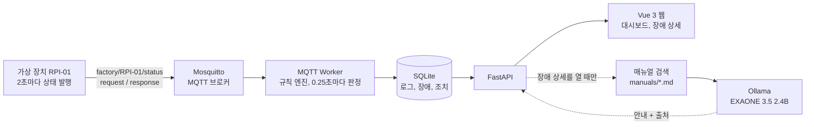

# 설비 통신 장애 대응 지원 웹

MQTT로 들어오는 설비 메시지를 규칙으로 감시해 통신 장애를 판정하고, 장애가 나면 **통신 로그, 점검 매뉴얼, 이전 조치 기록, 로컬 AI 점검 안내**를 한 화면에 모아 보여주는 웹입니다. 점검 후 남긴 조치는 같은 유형의 다음 장애에서 다시 보입니다.


> 장치를 끄면 10초 뒤 자동으로 장애가 판정되고, 장치를 다시 켜면 복구 시각이 자동으로 기록됩니다.

| 항목 | 내용 |
| --- | --- |
| 판정하는 장애 | 메시지 수신 중단 (10초), 응답 지연 (3초), 메시지 형식 오류 |
| 판정 정확도 | 기준 시간보다 최대 0.27초 안에 판정 (유형별 5회, 총 15회) |
| AI 안내 | 로컬 Ollama `exaone3.5:2.4b`, 매뉴얼 파일과 줄 번호를 출처로 표시 |
| 테스트 | 백엔드 자동 테스트 43개 통과 |
| 스택 | Python, paho-mqtt, FastAPI, SQLite, Mosquitto, Vue 3, Element Plus, ECharts, Ollama |

## 왜 만들었나

장애가 나면 담당자는 통신 로그, 점검 매뉴얼, 과거 조치 기록을 따로따로 찾아야 합니다. 점검하면서 무엇을 확인했는지도 남지 않아서 다음 대응에 쓰이지 않습니다. 이 프로젝트는 두 문제를 하나의 흐름으로 묶습니다.

```
메시지 수신 → 규칙 판정 → 장애와 로그 기록 → 근거 문서 기반 점검 안내 → 조치 기록 → 다음 장애에서 재사용
```

설계 원칙은 하나입니다. **판정은 규칙이 하고, AI는 설명만 돕습니다.** 장애 유형, 발생 시각, 복구 여부는 Python 규칙 엔진이 정합니다. AI는 이미 판정된 장애에 대해 매뉴얼과 로그를 근거로 점검 순서를 안내할 뿐, 원인을 확정하거나 장치를 제어하지 않습니다. 관련 매뉴얼이 없으면 모델을 호출하지 않고 근거 부족으로 표시합니다.

## 구조



- MQTT Worker와 FastAPI는 **별도 프로세스**입니다. 같은 SQLite 파일을 쓰지만, 수신과 판정은 API 서버가 멈춰도 계속됩니다.
- 모든 처리가 PC 안에서 이뤄집니다. AI도 로컬 모델이라 설비 로그가 외부로 나가지 않습니다.

### 판정 규칙

| 장애 | 코드 | 판정 기준 | 복구 판정 |
| --- | --- | --- | --- |
| 메시지 수신 중단 | `CONNECTION_TIMEOUT` | 마지막 유효 상태 메시지 후 10초 동안 다음 메시지 없음 | 정상 상태 메시지 재수신 |
| 응답 지연 | `RESPONSE_DELAY` | 요청 후 3초 안에 응답 없음 | 늦게라도 응답 도착 |
| 메시지 형식 오류 | `INVALID_MESSAGE` | 필수 필드 누락, 자료형 오류, JSON 파싱 실패 | 다음 정상 메시지 수신 |

## 화면

| 대시보드 | 장애 상세 및 대응 |
| --- | --- |
|  |  |
| 장치가 지금 살아 있는지 경과 시간과 10초 게이지로 표시합니다. 진행 중 장애, 점검 기록이 필요한 장애, 최근 15분 통신 추이를 함께 봅니다. | 판정 근거가 된 MQTT 로그, 같은 유형의 이전 조치, 관련 매뉴얼, AI 점검 안내, 체크리스트를 한 화면에서 봅니다. |

| 장애 이력 | 매뉴얼 및 조치 사례 |
| --- | --- |
|  |  |
| **통신 상태**(시스템이 자동 판단)와 **점검 기록**(사람이 남김)을 따로 표시합니다. 통신이 돌아와도 기록이 없으면 '점검 기록 필요'로 남습니다. | 점검 매뉴얼 4종, 실제로 저장된 조치 기록, 실습용 예시 사례를 검색합니다. |

## 해결한 문제

### 1. 장치가 돌아오면 가짜 응답 지연이 한꺼번에 기록됐다

**증상.** 장치를 끄고 10초 넘게 기다린 뒤 다시 켜면 메시지 수신 중단 1건과 함께 28초짜리 응답 지연이 여러 건 생겼습니다.

**원인.** 장치가 꺼져 있는 동안에도 Worker는 6초마다 요청을 발행했고, 이 요청이 브로커에 쌓였습니다. 장치가 다시 연결되자 쌓인 요청에 한꺼번에 응답했고, 엔진은 이를 "요청 후 28초 만에 온 응답"으로 판단했습니다. 장치가 죽은 것이 원인인데 장치가 느리다고 기록한 셈입니다.

**해결.**
- 최근 4초 안에 상태 메시지가 온 경우에만 요청을 발행합니다 (`device_alive`).
- 요청 후 3초가 지나도 응답이 없을 때, 그 사이 상태 메시지도 오지 않았다면 응답 지연이 아니라 장치 무응답(`NO_RESPONSE`)으로 로그만 남깁니다.
- 통신 중단 중에 보낸 요청은 표시해 두고, 재연결 후 늦게 온 응답은 `STALE` 로그로만 남깁니다.

**결과.** 장치를 끄고 켜는 시나리오에서 메시지 수신 중단 1건만 기록되고 복구까지 정상 처리됩니다.

### 2. 장치를 재시작하면 직전 요청이 응답 지연으로 남았다

**증상.** 요청을 보낸 직후 장치가 재시작되면, 그 요청에 대한 응답 지연 장애가 복구되지 않은 채 남았습니다.

**원인.** 재시작한 장치는 재시작 전에 받은 요청을 기억하지 못합니다. 그런데 엔진은 그 요청의 응답을 계속 기다렸습니다.

**해결.** 상태 메시지의 `sequence`가 이전 값보다 작거나 같아지면 장치가 재시작된 것으로 봅니다. 이때 재시작 전에 등록된 요청은 '재시작으로 유실'로 처리하고 대기 목록에서 지웁니다.

**결과.** 재시작이 응답 지연으로 잘못 기록되지 않습니다.

### 3. 감시 시스템이 멈춘 것을 장치 고장으로 기록할 뻔했다

**문제.** "10초 동안 메시지가 없으면 장애"라는 규칙만 있으면, Worker가 죽거나 브로커 연결이 끊겨도 장치 고장으로 기록됩니다. 장치는 멀쩡히 메시지를 보내고 있을 수도 있습니다.

**해결.** `/api/health`가 API, Worker, Broker, 장치 상태를 따로 보고하게 했습니다.

| 상황 | Worker | Broker | 웹의 장치 판단 | 장애로 남기나 |
| --- | --- | --- | --- | --- |
| Worker heartbeat가 3초 넘게 갱신 안 됨 | stopped | unknown | 확인 불가 | 남기지 않음 |
| Worker 정상, 브로커 연결 끊김 | running | disconnected | 확인 불가 | 남기지 않음 |
| 브로커 정상, 장치 메시지만 10초 이상 없음 | running | connected | 통신 끊김 | 메시지 수신 중단 |

**결과.** 감시 쪽이 멈추면 대시보드에 '상태 확인 불가'로만 표시하고 장애를 만들지 않습니다. 세 상황 모두 자동 테스트로 검증합니다.

그 밖에, 판정 직후 장애가 중복 생성되며 장애 ID가 건너뛰던 문제를 장애를 만들기 전에 진행 중 장애가 있는지 먼저 확인하도록 고쳤습니다.

## 실험 결과

PC 격리 환경에서 시뮬레이터 모드를 바꿔 장애를 실제로 발생시키고 측정했습니다. 원자료는 `experiments/`, 요약은 `presentation/experiment_summary.md`에 있습니다.

### 규칙 기반 판정 시간

| 유형 | 횟수 | 평균 | 범위 | 기준을 넘긴 시간 |
| --- | ---: | ---: | ---: | ---: |
| 메시지 수신 중단 | 5 | 10.106초 | 10.003~10.207초 | 최대 0.207초 |
| 응답 지연 | 5 | 3.190초 | 3.010~3.269초 | 최대 0.269초 |
| 메시지 형식 오류 | 5 | 5/5 판정 | 측정 불가 | 수신과 판정 시각의 해상도가 같음 |

- 기준을 넘긴 시간은 Worker가 0.25초마다 판정하기 때문에 생기는 차이로 볼 수 있습니다.
- 메시지 수신 중단은 마지막 유효 상태 수신부터, 응답 지연은 요청 등록부터 잽니다. 시작점이 달라 두 유형을 직접 비교하지 않습니다.

### 로컬 AI 응답 시간

| 호출 | 1 | 2 | 3 | 4 | 5 | 평균 | 중앙값 |
| --- | ---: | ---: | ---: | ---: | ---: | ---: | ---: |
| 응답 시간 | 8.908초 | 3.556초 | 3.641초 | 3.576초 | 3.638초 | 4.664초 | 3.638초 |

첫 호출은 모델 적재 시간이 포함된 것으로 보입니다. 5회 모두 같은 형식 오류 장애에 대한 호출이며, 성공은 답이 나왔다는 뜻이지 내용이 정확하다는 뜻이 아닙니다.

### AI 안내 근거 검토 (실제 응답 1건)

응답 지연 장애에 대한 AI 답변을 매뉴얼과 한 줄씩 대조했습니다. 결과는 **부분 적합**입니다. 장애 유형에 맞는 문서가 검색됐고 원인 후보도 가능성으로 표현했지만, '소프트웨어 업데이트 확인'처럼 매뉴얼에 없는 권고가 남았습니다. 그래서 AI 안내는 참고용으로만 쓰고, 이후 매뉴얼에 관련 로그 예시와 다른 장애와의 구분 기준을 보강했습니다. 상세 내용은 `presentation/ai_review.md`에 있습니다.

## 실행

Windows, Python 3.12, Node.js 22.18 이상 또는 24.12 이상, Mosquitto가 필요합니다. AI 안내를 쓰려면 Ollama와 `exaone3.5:2.4b` 모델이 필요합니다.

```powershell
py -m venv .venv
.\.venv\Scripts\python.exe -m pip install -r requirements.txt
cd frontend; npm ci; cd ..
ollama pull exaone3.5:2.4b
```

### 한 번에 실행 (시연용)

```powershell
.\scripts\start_demo.ps1    # 시연용 DB를 새로 만들고 브로커, Worker, API, 웹, 가상 장치를 띄움
.\scripts\device.ps1        # 장치 창을 닫았을 때 장치만 다시 실행
.\scripts\rehearsal.ps1     # 응답 지연, 형식 오류, 수신 중단을 차례로 실제 발생시킴
.\scripts\stop_demo.ps1     # 전부 종료
```

장치 창에서 Ctrl+C를 누르면 10초 뒤 장애가 판정되고, `device.ps1`로 다시 켜면 복구됩니다.

### 따로 실행

각 명령을 별도 PowerShell 창에서 프로젝트 루트 기준으로 실행합니다.

```powershell
& 'C:\Program Files\mosquitto\mosquitto.exe' -v
.\.venv\Scripts\python.exe -m backend.mqtt_worker
.\.venv\Scripts\python.exe -m uvicorn backend.main:app --host 127.0.0.1 --port 8000
.\.venv\Scripts\python.exe -m raspberry_pi.device_simulator --mode normal
cd frontend; npm run dev
```

- 웹: `http://localhost:5173`, API 문서: `http://127.0.0.1:8000/docs`, 상태: `http://127.0.0.1:8000/api/health`
- 시뮬레이터 `--mode`: `normal`, `disconnect`, `delay`, `invalid`. 다른 호스트에서 실행하면 `--host`에 브로커 IP를 지정합니다.
- 환경 변수: `MQTT_HOST`, `MQTT_PORT`, `REQUEST_INTERVAL_SECONDS`, `IOT_DB_PATH`, `OLLAMA_BASE_URL`, `OLLAMA_MODEL`, `OLLAMA_TIMEOUT_SECONDS`(기본 60초). `.env.example`은 참고용이며 자동으로 읽지 않습니다.
- Ollama가 꺼져 있거나 시간이 초과되면 AI 안내만 사용 불가로 표시되고, 수신과 판정, 조회는 계속 동작합니다.

### 테스트

```powershell
.\.venv\Scripts\python.exe -m pytest -q
```

### 실험 기록

실험은 `IOT_DB_PATH`로 분리한 실습 DB에서 합니다. `scripts/record_experiment.py`에 같은 장애 유형의 이벤트 ID 5개와 `--require-five`를 주면 CSV로 기록하고, `scripts/summarize_experiments.py`가 통계와 그래프를 만듭니다. 형식 오류의 소요 시간은 빈 값과 '측정 불가'로 남기며 0초로 처리하지 않습니다. 실험 CSV는 Git에서 제외합니다.

## 폴더 구조

```text
backend/        main.py(API), mqtt_worker.py(수신), engine.py(판정), db.py, rag.py(매뉴얼 검색, AI 안내)
frontend/       Vue 3 웹
raspberry_pi/   PC와 Raspberry Pi OS 공용 MQTT 장치 에이전트, 시뮬레이터
manuals/        장애 유형별 점검 매뉴얼 4종 (AI 안내의 근거 문서)
scripts/        시연 실행, 리허설, 화면 캡처, 실험 기록
experiments/    실험 기록 양식
tests/          백엔드 테스트
presentation/   발표 자료, 실험 요약, AI 근거 검토
docs/images/    README 이미지
```

## 한계와 다음 단계

- PC 시뮬레이터 장치 1대로만 검증했습니다. Raspberry Pi 5용 에이전트와 설치 절차([연동 가이드](RASPBERRY_PI_SETUP.md))는 준비돼 있지만, 실제 Ethernet 단절과 재연결 실험은 아직 하지 않았습니다.
- 실험은 판정 15회, AI 응답 5회, AI 근거 대조 1건으로 표본이 작습니다.
- 매뉴얼과 조치 사례는 실습용으로 직접 작성했습니다. 화면에서도 '예시'로 구분합니다.
- 다음 단계: Raspberry Pi 5 실기기 단절 실험, 장치 여러 대 동시 감시, AI 답변에서 근거 밖 문장 차단.
