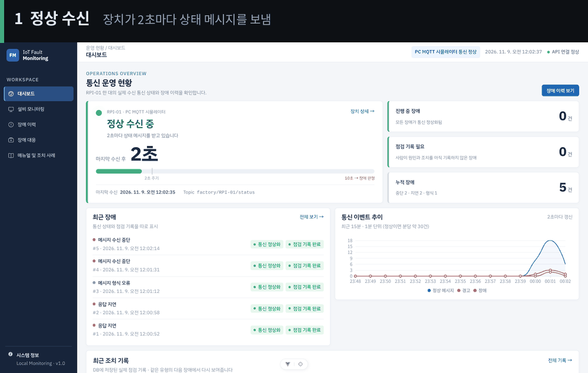
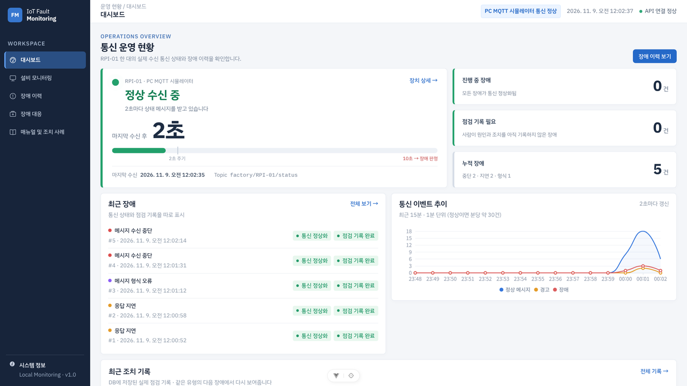
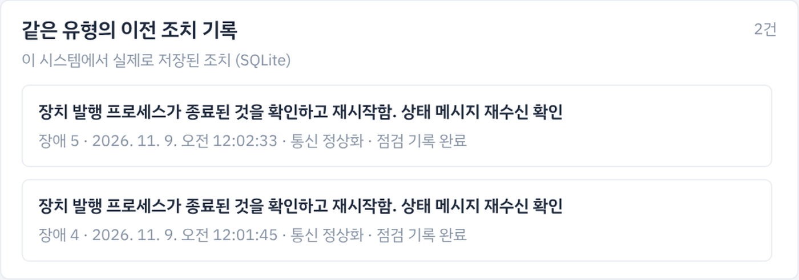
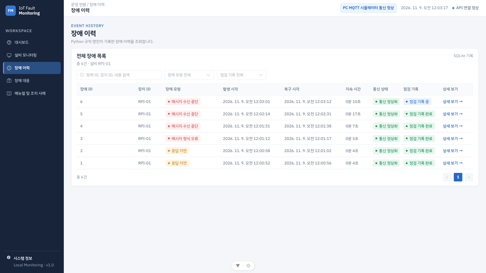
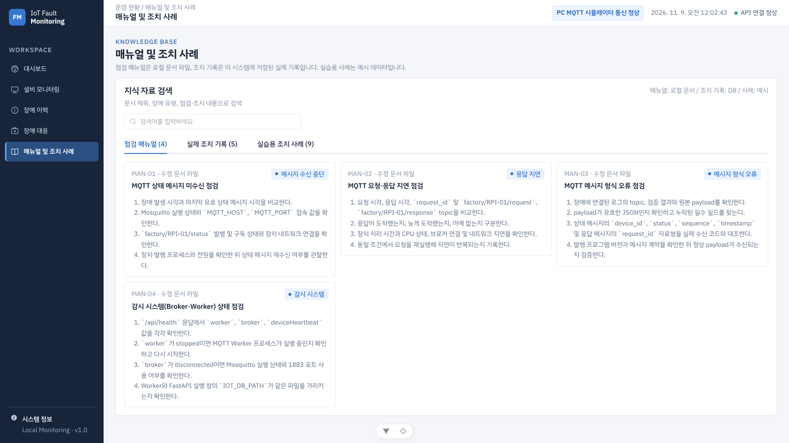

# 설비 통신 장애 대응 지원 웹

IoT 통신시스템응용 과목에서 진행한 개인 프로젝트입니다. MQTT로 들어오는 설비 메시지를 규칙 기반으로 감시해 통신 장애를 판정하고, 장애가 발생하면 관련 통신 로그와 점검 매뉴얼, 이전 조치 기록, 로컬 LLM의 점검 안내를 한 화면에서 확인할 수 있도록 구현했습니다. 점검 후 저장한 조치 기록은 같은 유형의 장애가 다시 발생했을 때 상세 화면에 함께 표시됩니다.



장치를 종료하면 약 10초 뒤 장애가 판정되고, 장치를 다시 실행하면 복구 시각이 자동으로 기록되는 과정입니다.

| 항목 | 내용 |
| --- | --- |
| 판정 대상 장애 | 메시지 수신 중단(10초), 응답 지연(3초), 메시지 형식 오류 |
| 판정 시간 | 판정 기준 대비 최대 0.27초 이내 (유형별 5회, 총 15회 측정) |
| AI 점검 안내 | Ollama `exaone3.5:2.4b` 로컬 모델, 근거 매뉴얼의 파일명과 줄 번호 표시 |
| 테스트 | 백엔드 자동 테스트 43개 |
| 사용 기술 | Python, paho-mqtt, FastAPI, SQLite, Mosquitto, Vue 3, Element Plus, ECharts, Ollama |

## 개발 배경

설비 통신 장애가 발생하면 작업자는 통신 로그, 점검 매뉴얼, 과거 조치 기록을 각각 따로 찾아봐야 합니다. 또한 점검 과정에서 어떤 항목을 확인했는지가 기록으로 남지 않아 이후 비슷한 장애가 발생했을 때 참고하기 어렵습니다. 이 프로젝트에서는 두 문제를 해결하기 위해 아래 흐름을 하나의 웹에서 처리하도록 구성했습니다.

```
메시지 수신 → 규칙 기반 판정 → 장애와 로그 기록 → 매뉴얼 기반 점검 안내 → 조치 기록 → 다음 장애에서 재사용
```

설계할 때는 장애 판정과 AI의 역할을 분리하는 것을 기준으로 삼았습니다. 장애 유형, 발생 시각, 복구 여부는 Python 규칙 엔진이 판단합니다. AI는 이미 판정된 장애에 대해 매뉴얼과 로그를 근거로 점검 순서를 안내하는 역할만 하며, 원인을 확정하거나 장치를 제어하지 않습니다. 관련 매뉴얼을 찾지 못한 경우에는 모델을 호출하지 않고 근거가 부족하다고 표시합니다.

## 시스템 구조


- MQTT Worker와 FastAPI는 별도 프로세스로 실행됩니다. 두 프로세스는 같은 SQLite 파일을 사용하지만, API 서버가 중단되어도 메시지 수신과 장애 판정은 계속 동작합니다.
- AI를 포함한 모든 처리를 로컬 PC에서 수행하므로 설비 로그가 외부로 전송되지 않습니다.

### 장애 판정 규칙

| 장애 | 코드 | 판정 기준 | 복구 판정 |
| --- | --- | --- | --- |
| 메시지 수신 중단 | `CONNECTION_TIMEOUT` | 마지막 유효 상태 메시지 수신 후 10초 동안 메시지 없음 | 정상 상태 메시지 재수신 |
| 응답 지연 | `RESPONSE_DELAY` | 요청 후 3초 이내에 응답 없음 | 지연된 응답 도착 |
| 메시지 형식 오류 | `INVALID_MESSAGE` | 필수 필드 누락, 자료형 오류, JSON 파싱 실패 | 다음 정상 메시지 수신 |

## 주요 화면

| 대시보드 | 장애 상세 및 대응 |
| --- | --- |
|  |  |
| 마지막 메시지 수신 후 경과 시간과 10초 게이지로 장치 상태를 표시합니다. 진행 중인 장애, 점검 기록이 필요한 장애, 최근 15분간의 통신 추이도 함께 확인할 수 있습니다. | 판정 근거가 된 MQTT 로그, 같은 유형의 이전 조치, 관련 매뉴얼, AI 점검 안내, 점검 체크리스트를 한 화면에 배치했습니다. |

| 장애 이력 | 매뉴얼 및 조치 사례 |
| --- | --- |
|  |  |
| 시스템이 자동으로 판단하는 통신 상태와 사용자가 남기는 점검 기록을 구분해 표시합니다. 통신이 복구되더라도 점검 기록이 없으면 '점검 기록 필요' 상태로 남습니다. | 점검 매뉴얼 4종, 실제로 저장된 조치 기록, 실습용 예시 사례를 검색할 수 있습니다. |

## 개발 중 해결한 문제

### 1. 장치 재연결 후 응답 지연 장애가 잘못 기록되는 문제

**현상**: 장치를 종료하고 10초 이상 지난 뒤 다시 실행하면, 메시지 수신 중단 장애와 함께 약 28초의 응답 지연 장애가 여러 건 기록되었습니다.

**원인**: 장치가 종료된 동안에도 Worker가 6초마다 요청을 발행했고, 이 요청들이 브로커에 쌓였습니다. 장치가 재연결되면서 쌓인 요청에 한꺼번에 응답했고, 규칙 엔진은 이를 요청 후 28초 만에 도착한 응답으로 판단했습니다. 실제 원인은 장치 종료인데 응답 지연으로 잘못 분류된 것입니다.

**해결 방법**
- 최근 4초 이내에 상태 메시지를 받은 경우에만 요청을 발행하도록 수정했습니다(`device_alive`).
- 요청 후 3초 동안 응답이 없고 그 사이 상태 메시지도 수신되지 않았다면, 응답 지연이 아닌 장치 무응답(`NO_RESPONSE`)으로 로그만 남기도록 했습니다.
- 통신 중단 중에 발행된 요청은 별도로 표시해 두고, 재연결 후 도착한 응답은 `STALE` 로그로만 기록하도록 했습니다.

**결과**: 장치를 종료했다가 다시 실행하는 시나리오에서 메시지 수신 중단 장애 1건만 기록되고, 복구까지 정상적으로 처리되는 것을 확인했습니다.

### 2. 장치 재시작 시 이전 요청이 응답 지연으로 남는 문제

**현상**: 요청을 보낸 직후 장치가 재시작되면, 해당 요청에 대한 응답 지연 장애가 복구되지 않은 상태로 남았습니다.

**원인**: 재시작된 장치는 재시작 이전에 받은 요청을 알지 못하지만, 규칙 엔진은 그 요청에 대한 응답을 계속 기다리고 있었습니다.

**해결 방법**: 상태 메시지의 `sequence` 값이 이전 값보다 작거나 같아지면 장치가 재시작된 것으로 판단하도록 했습니다. 이 경우 재시작 이전에 등록된 요청은 재시작으로 인해 유실된 것으로 처리하고 대기 목록에서 제거합니다.

**결과**: 장치 재시작이 응답 지연 장애로 잘못 기록되지 않습니다.

### 3. 감시 시스템 중단을 장치 고장으로 오판할 수 있는 문제

**문제**: "10초 동안 메시지가 없으면 장애"라는 규칙만 적용하면, Worker가 중단되거나 브로커 연결이 끊긴 경우에도 장치 고장으로 기록됩니다. 이때 장치는 정상적으로 메시지를 보내고 있을 수도 있습니다.

**해결 방법**: `/api/health`에서 API, Worker, Broker, 장치 상태를 각각 구분해 보고하도록 했습니다.

| 상황 | Worker | Broker | 장치 상태 판단 | 장애 기록 여부 |
| --- | --- | --- | --- | --- |
| Worker heartbeat가 3초 이상 갱신되지 않음 | stopped | unknown | 확인 불가 | 기록하지 않음 |
| Worker 정상, 브로커 연결 끊김 | running | disconnected | 확인 불가 | 기록하지 않음 |
| 브로커 정상, 장치 메시지만 10초 이상 없음 | running | connected | 통신 끊김 | 메시지 수신 중단 |

**결과**: 감시 시스템에 문제가 있는 경우 대시보드에 '상태 확인 불가'로만 표시하고 장애는 생성하지 않습니다. 세 가지 상황은 모두 자동 테스트로 검증했습니다.

이 외에도 장애 판정 직후 같은 장애가 중복 생성되어 장애 ID가 건너뛰는 문제가 있었는데, 장애를 생성하기 전에 진행 중인 장애가 있는지 먼저 확인하도록 수정했습니다.

## 실험 결과

PC 환경에서 시뮬레이터의 동작 모드를 바꿔 장애를 실제로 발생시키고 판정 시간을 측정했습니다. 원본 데이터는 `experiments/`, 요약은 `presentation/experiment_summary.md`에 있습니다.

### 규칙 기반 판정 시간

| 유형 | 횟수 | 평균 | 범위 | 판정 기준 초과 시간 |
| --- | ---: | ---: | ---: | ---: |
| 메시지 수신 중단 | 5 | 10.106초 | 10.003~10.207초 | 최대 0.207초 |
| 응답 지연 | 5 | 3.190초 | 3.010~3.269초 | 최대 0.269초 |
| 메시지 형식 오류 | 5 | 5/5 판정 | 측정 불가 | 수신 시각과 판정 시각의 기록 해상도가 같음 |

- 판정 기준을 초과한 시간은 Worker가 0.25초 주기로 판정하기 때문에 발생하는 차이로 판단됩니다.
- 메시지 수신 중단은 마지막 유효 상태 메시지 수신 시점부터, 응답 지연은 요청 등록 시점부터 측정했습니다. 측정 시작점이 다르기 때문에 두 유형을 직접 비교하지는 않았습니다.

### 로컬 AI 응답 시간

| 호출 | 1 | 2 | 3 | 4 | 5 | 평균 | 중앙값 |
| --- | ---: | ---: | ---: | ---: | ---: | ---: | ---: |
| 응답 시간 | 8.908초 | 3.556초 | 3.641초 | 3.576초 | 3.638초 | 4.664초 | 3.638초 |

첫 번째 호출은 모델을 메모리에 불러오는 시간이 포함되어 길게 측정된 것으로 보입니다. 다섯 번 모두 같은 메시지 형식 오류 장애에 대한 호출이며, 여기서 성공은 응답이 생성되었다는 의미일 뿐 내용의 정확도를 뜻하지는 않습니다.

### AI 점검 안내 근거 검토

응답 지연 장애에 대한 실제 AI 응답 1건을 매뉴얼과 비교해 검토했습니다. 장애 유형에 맞는 문서가 검색되었고 원인 후보도 가능성 수준으로 표현했지만, '소프트웨어 업데이트 확인'처럼 매뉴얼에 없는 권고가 포함되어 있어 **부분 적합**으로 판단했습니다. 이 결과를 바탕으로 AI 안내는 참고용으로만 사용하고, 매뉴얼에 로그 예시와 다른 장애와의 구분 기준을 추가했습니다. 자세한 내용은 `presentation/ai_review.md`에 정리했습니다.

## 실행 방법

Windows 환경에서 Python 3.12, Node.js 22.18 이상 또는 24.12 이상, Mosquitto가 필요합니다. AI 점검 안내를 사용하려면 Ollama와 `exaone3.5:2.4b` 모델이 추가로 필요합니다.

```powershell
py -m venv .venv
.\.venv\Scripts\python.exe -m pip install -r requirements.txt
cd frontend; npm ci; cd ..
ollama pull exaone3.5:2.4b
```

### 시연용 일괄 실행

```powershell
.\scripts\start_demo.ps1    # 시연용 DB 생성 후 브로커, Worker, API, 웹, 가상 장치 실행
.\scripts\device.ps1        # 가상 장치만 다시 실행
.\scripts\rehearsal.ps1     # 응답 지연, 형식 오류, 수신 중단을 순서대로 발생
.\scripts\stop_demo.ps1     # 전체 종료
```

장치 창에서 Ctrl+C를 누르면 약 10초 뒤 장애가 판정되고, `device.ps1`로 장치를 다시 실행하면 복구됩니다.

### 개별 실행

각 명령은 프로젝트 루트에서 별도의 PowerShell 창으로 실행합니다.

```powershell
& 'C:\Program Files\mosquitto\mosquitto.exe' -v
.\.venv\Scripts\python.exe -m backend.mqtt_worker
.\.venv\Scripts\python.exe -m uvicorn backend.main:app --host 127.0.0.1 --port 8000
.\.venv\Scripts\python.exe -m raspberry_pi.device_simulator --mode normal
cd frontend; npm run dev
```

- 웹: `http://localhost:5173`, API 문서: `http://127.0.0.1:8000/docs`, 상태 확인: `http://127.0.0.1:8000/api/health`
- 시뮬레이터 `--mode`는 `normal`, `disconnect`, `delay`, `invalid` 중 하나를 선택합니다. 다른 호스트에서 실행할 때는 `--host`에 브로커 IP를 지정합니다.
- 환경 변수는 `MQTT_HOST`, `MQTT_PORT`, `REQUEST_INTERVAL_SECONDS`, `IOT_DB_PATH`, `OLLAMA_BASE_URL`, `OLLAMA_MODEL`, `OLLAMA_TIMEOUT_SECONDS`(기본 60초), `OLLAMA_NUM_PREDICT`(생성 길이, 기본 700), `AI_EVIDENCE_LIMIT`(근거 절 수, 기본 6)를 사용합니다. 그래픽카드가 없는 노트북처럼 CPU로만 모델을 돌리면 응답이 느리므로 생성 길이와 근거 절 수를 줄이고 제한 시간을 늘려 실행합니다. `.env.example`은 참고용이며 자동으로 읽지 않습니다.
- Ollama가 실행 중이 아니거나 응답 시간이 초과되면 AI 안내만 사용할 수 없다고 표시되며, 메시지 수신과 장애 판정, 조회 기능은 정상 동작합니다.

### 테스트

```powershell
.\.venv\Scripts\python.exe -m pytest -q
```

### 실험 기록

실험은 `IOT_DB_PATH`로 운영 DB와 분리한 실습 DB에서 진행합니다. `scripts/record_experiment.py`에 같은 장애 유형의 이벤트 ID 5개와 `--require-five` 옵션을 지정하면 결과가 CSV로 기록되고, `scripts/summarize_experiments.py`로 통계와 그래프를 생성할 수 있습니다. 메시지 형식 오류의 소요 시간은 빈 값과 '측정 불가'로 기록하며 0초로 처리하지 않습니다. 실험 CSV 파일은 Git에서 제외했습니다.

## 폴더 구조

```text
backend/        main.py(API), mqtt_worker.py(수신), engine.py(판정), db.py, rag.py(매뉴얼 검색, AI 안내)
frontend/       Vue 3 웹
raspberry_pi/   PC와 Raspberry Pi OS 공용 MQTT 장치 에이전트, 시뮬레이터
manuals/        장애 유형별 점검 매뉴얼 4종 (AI 안내의 근거 문서)
scripts/        시연 실행, 리허설, 화면 캡처, 실험 기록
experiments/    실험 기록 양식
tests/          백엔드 테스트
presentation/   발표 자료, 실험 요약, AI 근거 검토
docs/images/    README 이미지
```

## 한계 및 향후 계획

- PC에서 실행한 시뮬레이터 장치 1대로만 검증했습니다. Raspberry Pi 5용 에이전트와 설치 절차([연동 가이드](RASPBERRY_PI_SETUP.md))는 준비했지만, 실제 Ethernet 연결 단절 및 재연결 실험은 아직 진행하지 못했습니다.
- 판정 시간 15회, AI 응답 시간 5회, AI 근거 검토 1건으로 실험 표본이 작습니다.
- 점검 매뉴얼과 조치 사례는 실습을 위해 직접 작성한 자료이며, 화면에서도 예시 데이터로 구분해 표시합니다.
- 향후에는 Raspberry Pi 5 실기기를 이용한 통신 단절 실험, 여러 장치의 동시 감시, AI 응답에서 근거에 없는 문장을 걸러내는 기능을 추가할 계획입니다.
